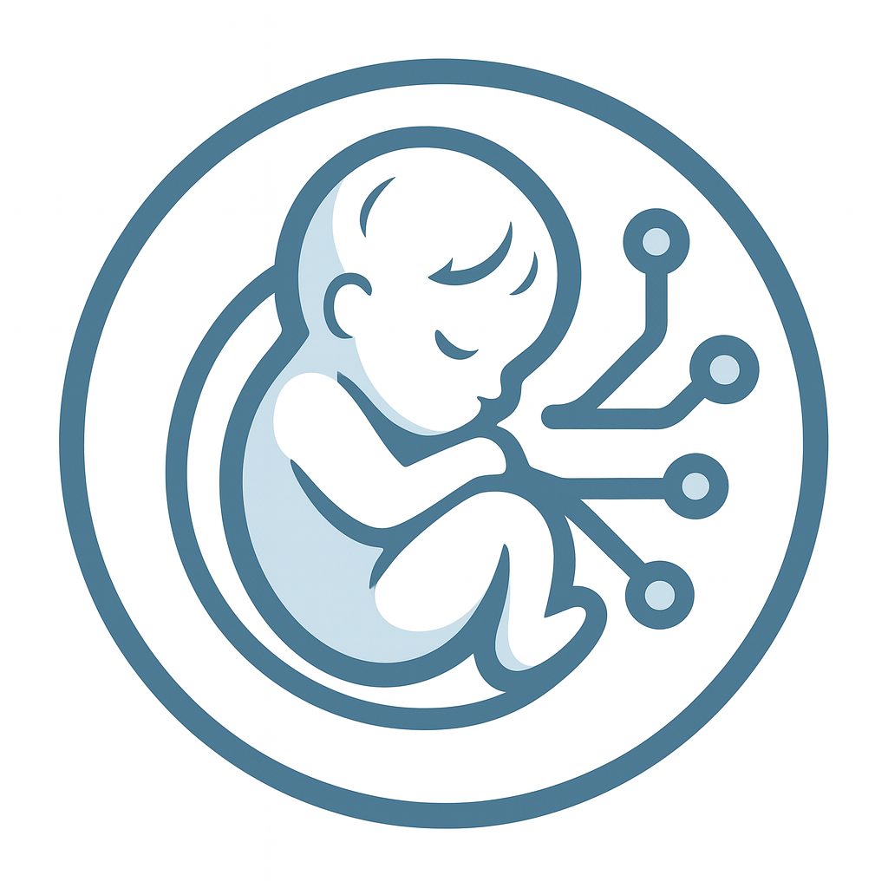
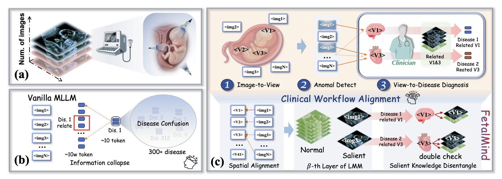
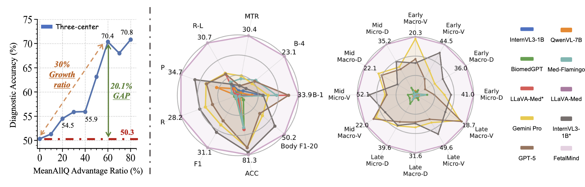

<p align="center">
    
</p>
<div align="center">
<h1 align="center"> KDD'26 Oral | FetalMind: Epistemic-aware Vision–Language Foundation Model for Fetal Ultrasound Interpretation</h1>


<h4 align="center"><em>Xiao He<sup>*,1</sup>, Huangxuan Zhao<sup>*,†,1</sup>, Guojia Wan<sup>1</sup>, Jiancheng Pan<sup>2</sup>, Yanxing Liu<sup>3</sup></em></h4>

<h4 align="center"><em>Xin Zou<sup>4</sup>, Yong Luo<sup>5</sup>, Yongchao Xu<sup>5</sup>, Juhua Liu<sup>1</sup>, Wei Zhou<sup>6</sup>, Dacheng Tao<sup>7</sup>, Bo Du<sup>†,1</sup></em></h4>
<p align="center">
    <sup>1</sup> Wuhan University;&nbsp;
    <sup>2</sup> Tsinghua University;&nbsp;
    <sup>3</sup> University of the Chinese Academy of Sciences;<br>
    <sup>4</sup> HKUST (Guangzhou);&nbsp;
    <sup>5</sup> Renmin Hospital of Wuhan University;&nbsp;
    <sup>6</sup> Wuhan Supercomputing Center;&nbsp;
    <sup>7</sup> Nanyang Technological University
</p>

<sup>*</sup> *Equal contribution* &nbsp; &nbsp; <sup>†</sup> *Corresponding author*

</div>

<p align="center">
    <a href="https://arxiv.org/abs/2510.12953"></a>
    <!-- <a href="http://arxiv.org/abs/2408.09110"></a> -->
    <a href="https://hexiao0275.github.io/FetalMind/">"></a>
    <a href="https://huggingface.co/natureteam/DeepFetal"></a>
    <a href="https://github.com/hexiao0275/FetalMind/blob/main/LICENSE"></a>
</p>

<p align="center">
  <a href="#news">News</a> |
  <a href="#open-source">Open Source</a> |
  <a href="#abstract">Abstract</a> |
  <a href="#statement">Statement</a>
</p>


## News
- [2026/05/17] Our FetalMind is accepted by KDD 2026 (Oral, CCF-A).  Congrats to our team!

- [2025/12/20] We are enhancing the security of the model, which will be uploaded to Hugging Face at this time.

- [2025/12/20] We are enhancing the security of the model, which will be uploaded to Hugging Face at this time.

- [2025/10/16] The paper and project report have been released.

- [2025/10/15] We are actively working to obtain the necessary approvals for dataset release and plan to make a partially de-identified version publicly available after the paper is accepted.

## Open Source

The implementation of **FetalMind**, our deconfounded multimodal AI system for fetal ultrasound interpretation, is available on GitHub.

<p align="center">
    <a href="https://github.com/hexiao0275/DeepFetal">
        
    </a>
</p>

## Abstract

A fetal vision–language foundation model, **FetalMind**, pretrained on multi-center fetal ultrasound data, integrating structured clinical knowledge and reinforcement learning for report generation and diagnostic reasoning across diverse gestational stages.

<p align="center">
    
</p>
<p align="center">
    
</p>

## Statement

### Acknowledgement

Sincerely thank [Jiancheng Pan](https://jianchengpan.space/) and [Yanxing Liu](https://yanxingliu.github.io/) for their valuable contributions and support to this project.


### Citation


If you are interested in the following work or want to use our dataset, please cite the following paper.

```
      @misc{he2025fetalmind,
        title={Epistemic-aware Vision-Language Foundation Model for Fetal Ultrasound Interpretation}, 
        author={Xiao He, Huangxuan Zhao, Guojia Wan, Jiancheng Pan, Yanxing Liu, Xin Zou, Yong Luo, Yongchao Xu, Juhua Liu, Wei Zhou, Dacheng Tao, Bo Du},
        year={2025},
        eprint={2505.12953},
        archivePrefix={arXiv},
        primaryClass={cs.CV},
        url={https://arxiv.org/abs/2510.12953}, 
        } 
```
